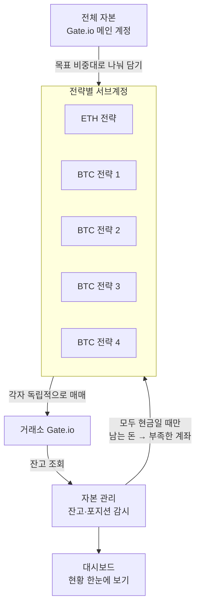

# Gate.io 무기한선물 포트폴리오 거래 봇

Gate.io USDT 무기한 선물 위에서 **여러 전략을 서브계정으로 분리**하고, 일정 주기로 자본을 배분·이전하는 실거래 시스템입니다.

이 저장소는 이력서/포트폴리오 제출용 공개본입니다. 실거래 파라미터, API 키, 계정 UID, Pine 원본, 백테스트 CSV는 포함하지 않습니다.

## 무엇을 보여주나

- **자본 배분**:  전체 자본 기준 일정 비중으로 자본을 분배한 후 각 계정 포지션 진입
- **서브계정 리밸런싱**: 모든 서브 계정이 플랫(포지션 없음)일 때만 분배 비율에 따라 계산된 잉여자금을 부족 계정으로 이전 (부분 체결/이체 재시도 포함)
- **리스크 가드**: 거래당 손실 리스크 한도, 레버리지 캡, 최대 손절폭, 전체 계좌 실시간 MDD 측정
- **실거래 인프라**: HMAC 서명 REST, WebSocket 가격, 봉 마감 진입, 가격 트리거 TP/SL, Discord/Kakao 알림
- **운영**: Ubuntu systemd (`install.sh`), 로컬 대시보드 (`python -m portfolio_engine.dashboard`)

한 덩어리의 돈을 여러 계좌에 나눠 담고, 각 계좌가 자기 전략으로 따로 거래합니다. 포지션이 전부 청산된 뒤에만 남는 돈을 부족한 계좌로 옮기고, 대시보드에서 전체를 봅니다.



## 레이아웃

| 경로 | 역할 |
|------|------|
| `portfolio_engine/` | 전체 컨트롤러, 이체, MDD, 성과 대시보드 |
| `gateio_eth_strategy1/` | ETH 전략 |
| `gateio_btc_strategy1/` | BTC 전략 1 |
| `gateio_btc_strategy2/` | BTC 전략 2 |
| `gateio_btc_strategy3/` | BTC 전략 3 |
| `gateio_btc_strategy4/` | BTC 전략 4 |

공통 패턴: `config.py, .env` (키·파라미터) → `gate_client.py` (주문/캔들) → `indicators.py` (지표 계산) → `strategy.py` (신호) → `main.py` (루프, 봉 마감, TP/SL).

## 공개본에서 빠진 것

- `.env` 및 API 키, 웹훅, 카카오 토큰
- `config.py` (튜닝값, 서브계정 UID, 원금) — gitignore. 공개 템플릿은 `config.example.py`
- `indicators.py` (지표 계산) — gitignore. 공개 템플릿은 `indicators.example.py` (함수 시그니처만)
- TradingView `.pine` 원본
- 백테스트/실거래 CSV, `allocation.json` 실데이터, 런타임 state

`config.example.py` 기본값은 교과서적인 예시이며 `DRY_RUN=1(모의 거래)` 입니다. 실거래 값과 다릅니다.

로컬에서 구조를 확인하려면:

```bash
cp portfolio_engine/.env.example portfolio_engine/.env
# 각 슬리브 .env.example → .env 후 GATE_API_KEY / GATE_API_SECRET 만 채움
# 클론 후 봇을 import 하려면:
#   cp config.example.py config.py
#   cp indicators.example.py indicators.py
```

## 실행 (구조 확인용)

```bash
python -m venv .venv
.venv\Scripts\activate   # Linux: source .venv/bin/activate
pip install -r requirements.txt

# 대시보드 (키 없으면 API 호출에서 실패하는 것이 정상)
python -m portfolio_engine.dashboard

# 개별 봇은 해당 폴더에서
python main.py
```

서버 설치 스크립트는 루트 `install.sh` (systemd: controller + 4 sleeves + dashboard).

## 설계 메모

- 전략 봇은 자기 선물 잔고가 아니라 `allocation.json`의 `allocated[sleeve]`로 사이징한다.
- 컨트롤러는 1분 폴링으로 마크(선물 + 스팟)를 모으고, 이체는 플랫일 때만 실행해 포지션 위에 자본이 빠지지 않게 한다.
- TP/SL은 시장가 폴링이 아니라 Gate 가격 트리거 주문으로 등록한다.

